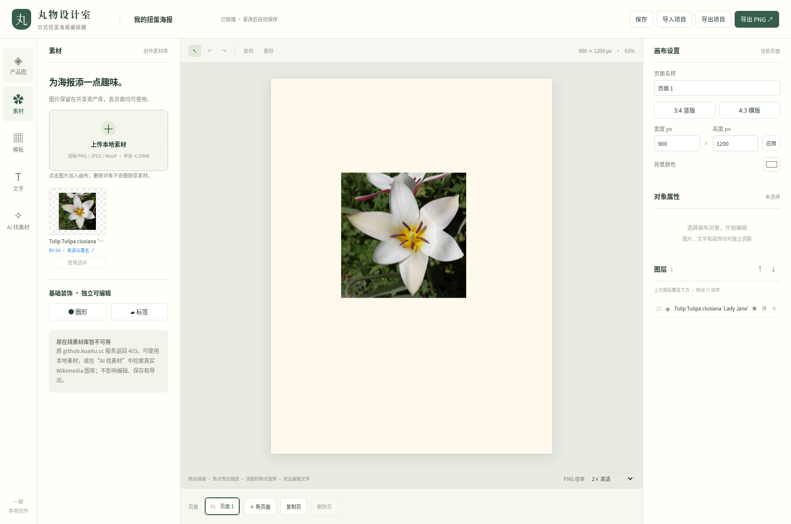

# 第二阶段验收

2026-10-15，分支 `feat/ai-material-search`。按用户最新选择：**暂不配置密钥、不付费**，默认进入免费真实关键词检索；AI 能力保留为可选服务端实现，未配置时不可调用。

## 结果区分

| 能力 | 实际状态 |
| --- | --- |
| Wikimedia Commons 官方检索 | 真实网络请求成功；不是模拟响应 |
| 真实图片预览、导入与保存 | 浏览器完整流程通过，来源/授权/署名随资产和项目保留 |
| Openverse | 已评估官方匿名 API；本次返回 403 / Cloudflare 验证页，未标为接通 |
| AI 需求提取与三语关键词 | 服务端代码及结构/上下文校验测试通过；未配置真实密钥，未实测付费调用 |
| AI 图片筛选与推荐理由 | 服务端图片请求和筛选测试通过；未配置真实密钥，未实测付费调用 |
| 第一阶段编辑与保存 | 原 14 组浏览器流程全部通过，0 个页面异常 |

Openverse 不可用后，本轮先完成 Wikimedia Commons 官方直连这一条真实来源，界面明确标注实际入口。未扩展 SearXNG 或更多图库，不用假结果填补失败。

## 执行的验证

- 锁文件安装：`pnpm install --frozen-lockfile --offline --store-dir=/workspace/.pnpm-store` 通过。
- 构建：`pnpm build` 通过。
- 原有与项目模块测试：`pnpm test:run`，**32/32 通过**。
- 新服务端测试：`pnpm test:server`，**13/13 通过**。
- 新工作台类型检查：`pnpm typecheck:poster` 通过。
- 新增/修改的 Vue、TypeScript 和测试文件 ESLint 通过。
- 免费透明素材实测：官方直连搜索 `flower icon` 返回 **12 条已验证透明 PNG**；再实际导入一张并重新解码检查，包含真实透明像素。0 次 AI 调用。见 [透明素材验证结果](phase-two/transparent-result.json)。
- 本机安全配置 CLI 在交互终端实测：隐藏输入、正确读取、600 权限、原子替换路径、Git 忽略均检查；使用测试字符串，未向 OpenAI 发请求，测试配置随后删除。
- `scripts/phase-one-smoke.cjs`：14 组旧功能回归通过，图片/文字/图层/多页/恢复/PNG/完整项目均可用。
- `scripts/material-search-live.cjs`：不拦截、不模拟来源及图片响应，实际请求 Wikimedia Commons 并执行下列流程。

真实浏览器流程：

1. 未配置 AI 时默认进入关键词模式，验证 AI 调用按钮禁用、配置说明清楚。
2. 官方直连搜索 `flower`，获得实际图片候选，核对提供者确实为 Wikimedia Commons。
3. 从服务端代理加载真实图片，验证响应状态及 PNG/JPEG/WebP 类型。
4. 显示作者、授权、来源链接和署名，勾选确认后加入共享素材库。
5. 点击素材放入画布。
6. 导出完整项目，检查嵌入图像及来源/署名与真实检索记录一致。
7. 刷新恢复，图像对象、共享素材和来源链接保持；0 个页面异常。

详见 [真实检索验收结果](phase-two/live-result.json)、[原编辑流程回归结果](phase-two/editor-regression.json)。



[真实搜索结果截图](phase-two/real-results.png) · [安全配置状态截图](phase-two/configuration.png)

## 自动测试覆盖的边界

服务端自动测试使用显式注入的测试响应，验证：

- Openverse 参数、保守授权过滤、空结果和错误格式不补造结果。
- Commons 官方元数据与作者 HTML 的纯文本处理，不把未知授权算作可用。
- 固定下载域名、每跳重定向复核、拒绝本机/内网/任意 URL 代理及 SVG 伪图片。
- 真实 alpha 像素判定，白底 PNG、JPEG 和超大图不算透明。
- AI 请求包含完整补充要求；视觉请求使用实际图片数据，未知 token 或非法模型结果被拒绝。
- 无密钥明确失败；状态接口不泄漏密钥；服务端只接受有效近期结果 token 的导入。
- 授权确认、过期结果、同源限制、透明要求导入时再检查。
- 来源/授权信息随项目 JSON 保留，恶意来源链接被拒绝。

这些测试中的模型响应**不是线上 AI 结果**，没有在产品里启用“演示搜索”或假数据模式。仓库生产代码只请求实际服务。

## 费用与凭据

本轮没有进行 OpenAI 付费调用，也没有配置真实 API 密钥。未来可运行 `pnpm ai:configure`，安全写入被 Git 忽略的 `server/.env.local`。密钥不进入 Vue 前端、构建产物、安装脚本或 GitHub。具体名称和费用说明见 [使用指南](第二阶段使用指南.md)。

网页上的“已配置”仅表示服务端读到值，不代表授权已实测；错误密钥、限流、网络失败均明确显示。取消前端等待不承诺撤销已经发出的计费请求。

## 当前限制

- Openverse 当前网络返回验证页；保留适配器，但不能宣称已完成它的真实接入。
- AI 自然语言/图片流程仍需未来用户自愿配置密钥后，进行真实调用验证。本轮不需要用户购买服务。
- 免费关键词模式不理解“更复古/不要人物”等自然语言要求，也不生成三语词；这些属于明确标注、尚未配置的 AI 模式。免费模式可用英文关键词及严格透明 PNG 选项。
- 严格透明筛选目前仅验证 PNG；PNG 解码、尺寸、下载大小和源站可用性可能使结果减少。没有结果会如实显示。
- 当前一批最多请求 12 张索引，AI 模式最多分析其中 6 张；结果 token 30 分钟后或服务重启后失效。未实现更多来源或无限翻页。
- 原依赖体积、工具弃用与旧代码警告未整体清理；全仓库旧类型错误和安全审计问题仍见第一阶段验收。没有将开发服务暴露公网。
- 第一阶段许可证保留。截图中实际图库照片的许可见下文，不能将这些照片视为 MIT 许可。

## 截图照片署名与许可

`real-results.png` 和 `imported-material.png` 中显示的图库照片：

**Tulip Tulipa clusiana 'Lady Jane' Rock Ledge Flower Edit 2000px.jpg** — Photo by and (c)2007 **Derek Ramsey (Ram-Man)**. **Co-attribution must be given to the Chanticleer Garden.**

来源：[Wikimedia Commons 原图页面](https://commons.wikimedia.org/wiki/File:Tulip_Tulipa_clusiana_%27Lady_Jane%27_Rock_Ledge_Flower_Edit_2000px.jpg)。许可：[CC BY-SA 3.0](https://creativecommons.org/licenses/by-sa/3.0/)。截图将照片缩放并置于编辑器界面中；这两张含照片的截图按 CC BY-SA 3.0 提供。应用源代码的原 MIT LICENSE 保持不变。

## 复跑

先运行 `pnpm dev --strictPort`，安装独立 Playwright 工具并指定系统 Chromium 路径后：

```sh
PLAYWRIGHT_MODULE_PATH=/workspace/.cloud-tools/node_modules node scripts/material-search-live.cjs
```

这是云端验收示例，Mac 请使用本机 Playwright 工具路径与 Chrome/Chromium 可执行路径。输出目录默认 `/tmp/gashapon-materials-live`，可通过 `MATERIAL_ARTIFACTS` 修改。每次新运行清理旧结果标记，失败时退出非零并保存当次错误，不会将上一轮结果当作当次通过。该脚本**只做免费关键词检索，不调用 AI**。
